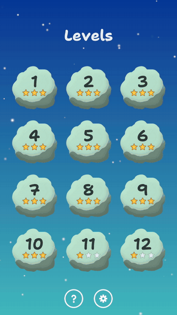
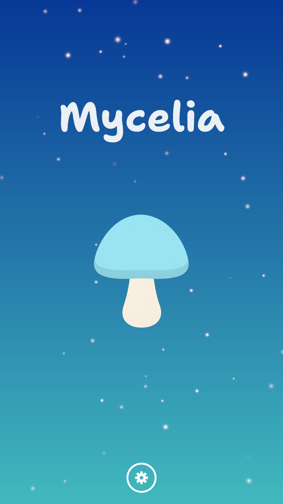
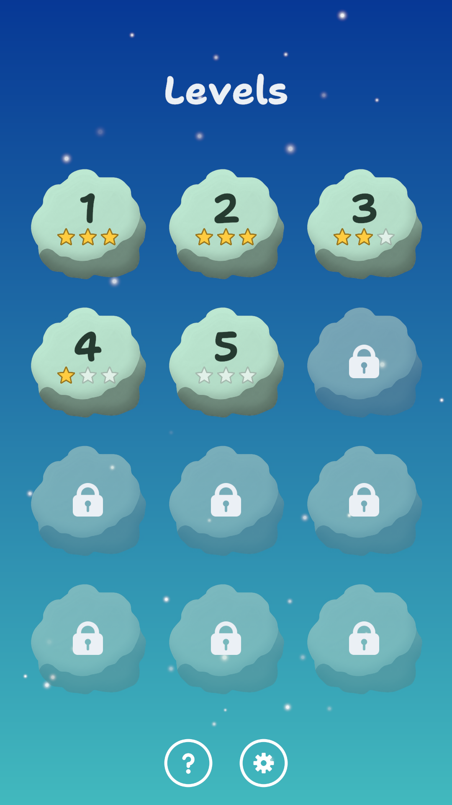
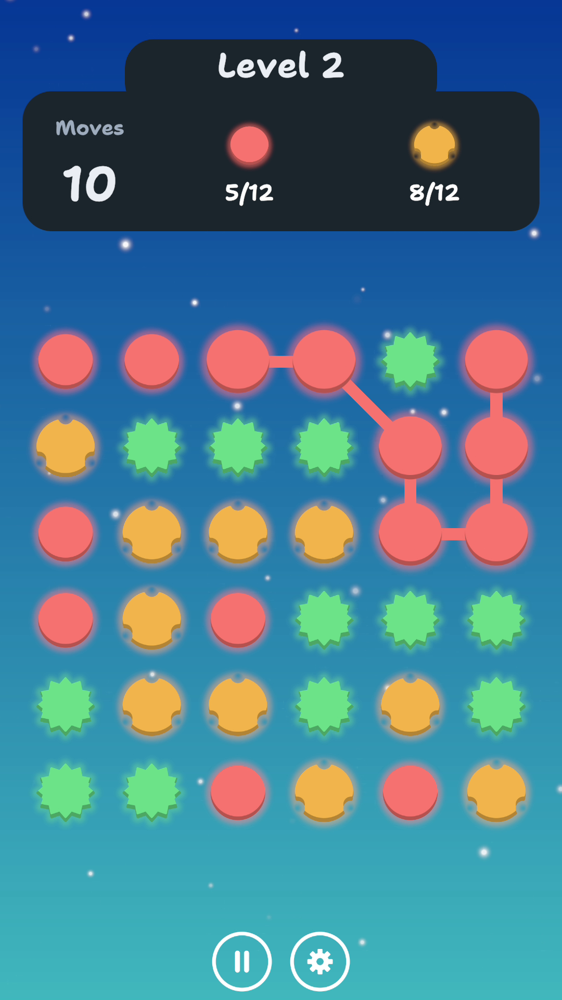
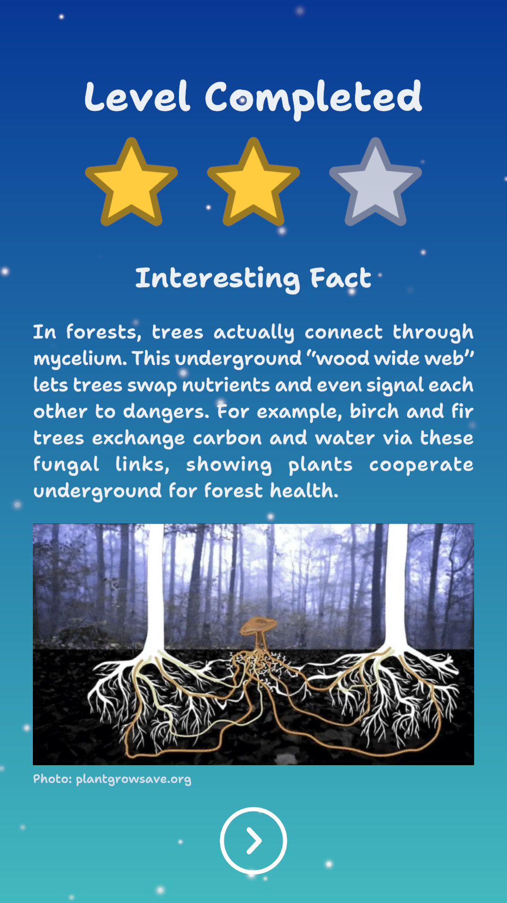

# Mycelia

A portrait, one-thumb puzzle game for Android about the hidden networks of fungi. Drag through neighbouring spores of the same kind to clear them, finish each level's collection goals within its moves, and unlock a short fact about what mycelium can do.

**[Download the APK on itch.io](https://soniseli.itch.io/mycelia)** (free, Android 8.0 or later, 64-bit ARM) · v1.0.0

<p align="center">
  
</p>

<p align="center">
  
  
  
  
</p>

Mycelia is a portfolio project: a complete, small mobile game built from scratch in Unity 6 to show how I work as a Unity mobile engineer. Game rules you can test, performance measured on a real phone against a budget set before the code, and every significant decision written down with its reason.

> **Prototype content.** The fact texts and photos are placeholders. See [Facts and photos](#facts-and-photos-prototype-placeholders) below.

## The game

- **12 hand-made levels**, unlocked in order. Each has a board (6 × 6 or 7 × 7), a number of moves and one to four goals ("collect 12 red spores").
- **Chains** go in all 8 directions, need at least 2 spores, and can be undone by dragging back. A chain commits when the finger lifts: the spores clear, the rest fall, new ones drop in, and a stuck board reshuffles for free.
- **1–3 stars** by moves left, no score. The best result is kept.
- **A fact card** after every win, with a photo.
- **Colour-blind friendly by design**: each spore type has its own outline (smooth, scalloped, spiked, notched) as well as its colour, checked in grayscale and colour-blindness simulations.
- A first-run intro, settings (sound effects, music, haptics), a pause overlay, and the Android back button on every screen.

## What was built

All code in this repository was designed and written from scratch for this project (the idea was first tried on an Asset Store template, which is not part of it).

- **An engine-free rules engine.** The board, chains, gravity, refill, reshuffle, goals, stars and the level's state machine are pure C# with no Unity references. A move runs through a fixed pipeline of phases and returns typed steps that the views play back.
- **Allocation-free play.** 0 bytes of garbage per move after warm-up, from the rules through input, playback, the HUD, sound and haptics, checked by tests and on the phone. Spore views are pooled before play and never instantiated during it.
- **About 11,500 lines of tests for about 7,800 lines of game code**: 681 EditMode tests in CI (rules written as text-grid boards, saves with golden files, scene and project guards) and 24 PlayMode tests run locally, including a 0-byte allocation test of move playback.
- **Guards on the project itself.** Tests fail if a scene breaks a UI rule, a font is missing a character a fact uses, a spore outline looks too much like another, the release keystore is left in the project settings, or the managed stripping level changes. Each guard was checked by breaking the code it guards.
- **A save system that doesn't lose progress.** Versioned JSON, atomic writes with a backup, bad records dropped one by one, an unreadable file set aside, and a newer file never overwritten. A win is saved before its celebration plays.
- **Levels balanced by a bot.** A greedy bot plays each level over 500 seeds in the Editor, and the levels are tuned until its win and star rates fall in a target band per level group ([balancing.md](docs/balancing.md)).
- **Mobile lifecycle**: pause on backgrounding and focus loss, the back button, safe areas, 60 fps in play and 30 fps on still screens, and screen fades that block input while scenes change.
- **Haptics and sound**: Android's vibrator effects through JNI, and sound effects and music synthesised by code for the project.
- **Local analytics** for playtests: level start and end with the seed, written to a file on the phone. Nothing leaves the device.
- **CI**: every push runs the EditMode tests and builds an Android APK with GameCI on GitHub Actions.

## Architecture

```
Mycelia.Domain      pure C#, no Unity: board, chains, move pipeline, goals, stars, session
      ▲
Mycelia.Content     ScriptableObjects: spore types, levels, catalogs (+ Editor validation)
      ▲
Mycelia.Game        views, input, playback, HUD, panels (MonoBehaviours)
      ▲
Mycelia.App         bootstrap, scene loading, save, settings, audio, haptics, analytics
```

Each layer is its own assembly and depends only on the ones below it. The full picture is in the [design document](docs/design.md) (§5), and every decision has a record in [docs/adr](docs/adr/README.md):

- **Domain apart from views** ([ADR-0003](docs/adr/0003-separate-pure-domain-from-views.md), [ADR-0004](docs/adr/0004-resolve-moves-through-a-phase-pipeline.md)). Committing a chain runs Clear → Trigger → Damage → Gravity → Refill → Hazards → Settle → Evaluate. Each phase's rules record typed steps in a reused `MoveResult`, and the Game layer plays them back phase by phase with input locked. A new mechanic is a new rule, step and step player, plus one line in the pipeline.
- **Seeded randomness** ([ADR-0007](docs/adr/0007-random-seed-per-attempt-with-pcg32.md)). The domain draws only through an injected PCG32 generator; every attempt gets a logged seed, so any board can be replayed exactly.
- **Data as assets** ([ADR-0005](docs/adr/0005-identify-spores-by-asset-with-runtime-id.md)). Spore types and levels are ScriptableObjects; the domain sees a 1-byte id, saves and analytics a stable key, and nothing uses colour as identity.
- **A hand-written composition root** ([ADR-0010](docs/adr/0010-hand-written-composition-root.md)). A Bootstrap scene creates the services once and passes them to each scene's single entry point. No singletons, no static state between scenes.
- **Saves** ([ADR-0006](docs/adr/0006-save-progress-as-versioned-json.md)) and **analytics** ([ADR-0014](docs/adr/0014-log-playtest-analytics-to-a-local-file.md)) behind interfaces that never throw.
- **Rendering and views** ([ADR-0002](docs/adr/0002-use-urp-with-2d-renderer.md), [ADR-0011](docs/adr/0011-fit-camera-to-board-and-pool-views-up-front.md), [ADR-0012](docs/adr/0012-use-ugui-with-textmeshpro.md)). URP with the 2D Renderer and unlit sprites; the board in world units with the camera fitted to it inside the safe area; uGUI with TextMeshPro, canvases split by how often they change, and allocation-free text updates.
- **Input and animation** ([ADR-0008](docs/adr/0008-pointer-action-and-grid-hit-testing.md), [ADR-0009](docs/adr/0009-animate-playback-with-primetween.md)). One Input System pointer action, mapped to cells with grid maths and a circular hit radius so diagonal drags don't catch side neighbours; each move's playback is one PrimeTween sequence.
- **Pause, haptics and sound** ([ADR-0013](docs/adr/0013-pause-the-level-and-handle-back.md), [ADR-0016](docs/adr/0016-drive-android-haptics-through-the-vibrator.md), [ADR-0017](docs/adr/0017-play-sound-with-playoneshot-behind-a-sound-interface.md)). Everything that animates or plays sound registers to pause with the level; `Time.timeScale` is never used.
- **Balancing** ([ADR-0015](docs/adr/0015-balance-levels-with-a-simulated-bot.md)). An Editor-only assembly runs the bot against the real domain.

## Performance

The budget was set before the code ([performance-budget.md](docs/performance-budget.md)) and measured on a **Xiaomi Redmi Note 12 Pro+ 5G** (Dimensity 1080, 8 GB, Android 13), a mid-range phone. The budget targets a low-end phone, and there is none to test with yet, so **every result is provisional**: a pass here doesn't prove the budget. Frame times come from an on-device probe in development builds, memory from `dumpsys meminfo` on release builds.

| Metric | Budget | Measured (mid-range phone) |
|---|---|---|
| Frame rate in play | stable 60 fps | 16.5 ms median frames in every window of play, including a 15-minute session ✅ |
| Frame rate on still screens | 30 fps | 33 ms frames ✅ |
| Garbage per move | 0 B after warm-up | 0 B, with sound and haptics on ✅ |
| Longest frame during a move | ≤ 25 ms | 0.45–2.2 ms to build a move's playback in release ✅ (development builds reach 31–46 ms on 7 × 7 boards: case study below) |
| Render thread | ≤ 2 ms median | 0.5–1.0 ms ✅ |
| SetPass calls | ≤ 10 | 5–10 on every screen ✅ (rare single frames of 16–18 where the engine draws the world camera twice: not traced) |
| Memory (PSS, release, at the peak) | ≤ 300 MB | level 11: 238–260 MB; main menu 231–253 MB ✅ |
| Texture / audio memory | ≤ 60 MB / ≤ 10 MB | 12.8 MB / 2.0 MB ✅ |
| Memory growth over 10 levels | ≤ 5 MB | +1.5 MB, no objects leaked between levels ✅ |
| Download size (Play, per ABI) | ≤ 40 MB | 28.5 MiB; the itch.io APK with the photos is 31.4 MiB ✅ |
| Cold start to level select | ≤ 3 s | 1.81 s ✅ |
| Level load (screen covered → board built) | ≤ 500 ms | 86–104 ms; 0.55–0.57 s from the tap with the two 0.25 s fades ✅ |
| 15-minute session | no thermal throttling | Android's thermal status 0 throughout ✅ |
| Overdraw, scripts-only CPU time | | not measured |

Six case studies in the budget tell how the harder numbers were found and fixed:

- **[77 batches and a budget measuring the wrong thing](docs/performance-budget.md#77-batches-and-a-budget-measuring-the-wrong-thing).** The idle board showed 77 batches against a budget of 30. Three test builds showed that URP's SRP Batcher counts every renderer as a batch while keeping the same 6 shader-state changes, at the same cost. The budget now limits render-thread time and SetPass calls instead of batches.
- **[246 MB before any content](docs/performance-budget.md#246-mb-before-any-content-fixed-overhead).** An empty scene already used 246 MB against a 200 MB budget. Variant builds (depth buffer, swapchain, shader variants, code stripping) showed it was the engine's fixed overhead, not content; only code stripping moved it. The budget went to 300 MB with the overhead explained.
- **[Allocations during play, found without a live Profiler](docs/performance-budget.md#allocations-during-play-found-without-a-live-profiler).** The phone's USB link couldn't carry the Profiler's stream, so the game recorded a capture on the phone and an Editor script read it headless. Two allocations came back every level from our code; both now happen at level load, with tests, and moves allocate 0 B.
- **[A 25 ms move that only development builds see](docs/performance-budget.md#a-25-ms-move-that-only-development-builds-see).** Big moves on 7 × 7 boards took 31–46 ms. Segmented captures and temporary markers traced it to PrimeTween's `Sequence.Insert` walking the whole sequence (n² in tweens per move) plus its development-only assertions; in release, building a move takes 0.45–2.2 ms.
- **[Two seconds of splash screen](docs/performance-budget.md#two-seconds-of-splash-screen-and-what-turning-it-off-cost).** Cold start measured 3.8 s against 3 s, with Unity's splash screen taking about 2 s of it. Turning it off brought cold start to 1.81 s; the extra memory it seemed to cost didn't reproduce in later builds.
- **[Seven megabytes the game never used](docs/performance-budget.md#seven-megabytes-the-game-never-used).** Managed stripping at four levels, plus the Build Report, found a font in `Resources`, post-processing data no camera used, and 21 unused engine modules. The APK went from 36.65 to 29.44 MiB and memory down by about 36 MB.

## Build and run

**Play it:** download the APK from [itch.io](https://soniseli.itch.io/mycelia) and install it on an Android phone (Android 8.0 or later, 64-bit ARM; allow installs from your browser or file manager when asked).

**Open the project:**

1. Install **Unity 6000.3.25f1** with Android Build Support.
2. Clone the repository and open it in Unity Hub. PrimeTween comes from its npm scoped registry, already set in `Packages/manifest.json`.
3. Press Play in any scene: the Editor starts through the Bootstrap scene, as the app does.
4. Run the tests from **Window → General → Test Runner** (EditMode and PlayMode).
5. Build for Android from **File → Build Profiles**. Builds from this repository show text-only fact cards (the photos are not in it) and are signed with a debug key; the itch.io APK is built and signed locally with the release key.

The levels' balance can be rechecked from **Mycelia → Simulate Levels**.

## Facts and photos (prototype placeholders)

The fact texts are placeholder text written for the prototype; they have not been fact-checked, and known problems are listed in [facts.md](docs/facts.md).

The photos on the fact cards (in the itch.io build and the media above) belong to their owners. Each card credits its source, and [facts.md](docs/facts.md) links the full source of every photo. They are used as unlicensed prototype placeholders, are not part of this repository, and will be removed if an owner asks: please open an issue or contact me through itch.io.

## Credits

- **Code, design and levels, the mushroom and the level-node shape**: Soni Seli. The spores, UI kit, backdrop, sound effects and music were made for this project (drawn or synthesised by code).
- **[Shantell Sans](https://github.com/arrowtype/shantell-sans)** by the Shantell Sans Project Authors (Shantell Martin with Arrow Type): SIL Open Font License 1.1.
- **[PrimeTween](https://github.com/KyryloKuzyk/PrimeTween)** by Kyrylo Kuzyk, installed from npm (not in the repository).
- **TextMeshPro** essential resources by Unity Technologies: Unity Companion License.
- **UN Sustainable Development Goal icons** 9, 12 and 13 (the intro's last page) by the United Nations, used under the [UN's SDG guidelines](https://www.un.org/sustainabledevelopment/news/communications-material/). The content of this game has not been approved by the United Nations and does not reflect the views of the United Nations or its officials or Member States.
- **Fact photos**: see [above](#facts-and-photos-prototype-placeholders).

The full list with licences is in the design document, [§10](docs/design.md#10-credits-and-provenance).

## Documentation

- [Design document](docs/design.md): rules, player flow, architecture, mobile, testing, milestones
- [Architecture decision records](docs/adr/README.md): why the code looks the way it does
- [Performance budget](docs/performance-budget.md): targets, method, results log, case studies
- [Balancing](docs/balancing.md): the bot, target bands and results

## Licence

Copyright © 2026 Soni Seli. **All rights reserved.** The source is public so it can be read and reviewed; it is not licensed for reuse or redistribution. Third-party parts keep their own licences (above).
